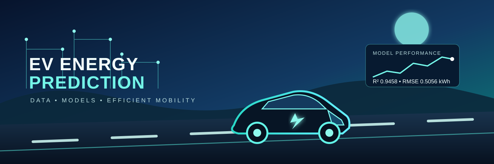
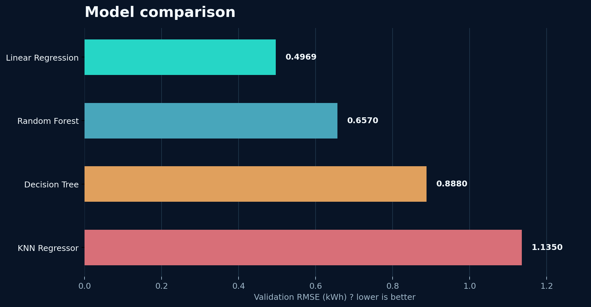
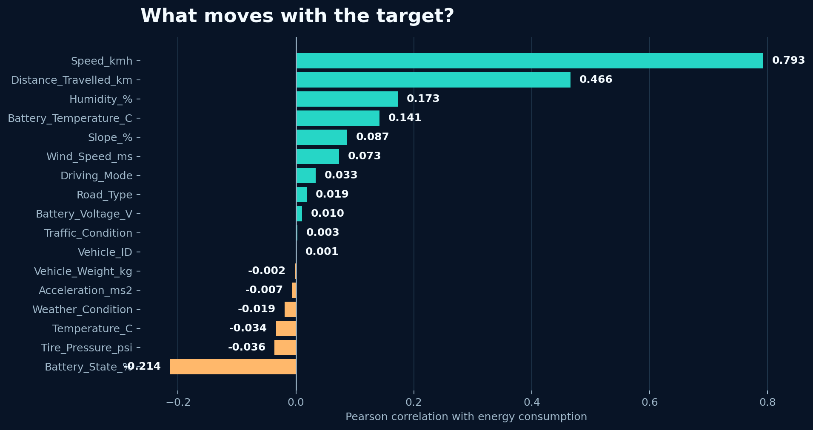
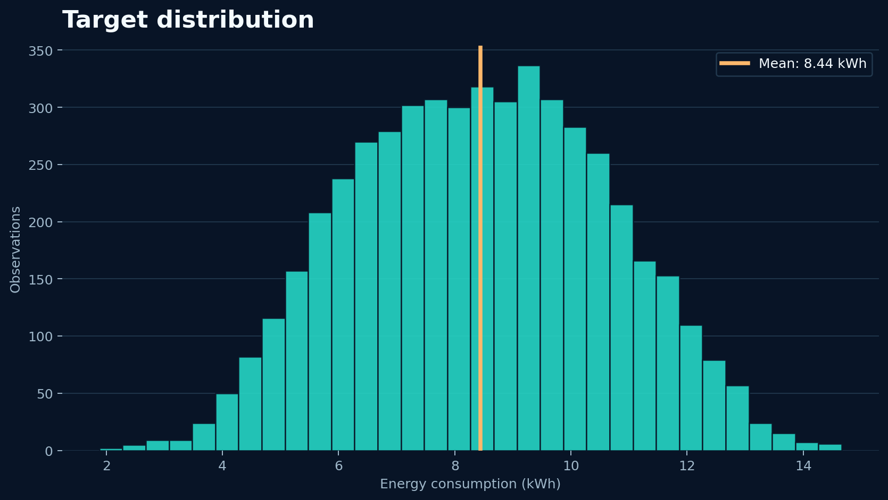

<div align="center">

# EV Energy Prediction

### A data-driven way to understand and predict electric-vehicle energy consumption

<p>
  
</p>

<p>
  <a href="https://github.com/Rama-AlJufout/EVEnergyPrediction"></a>
  
  
  
</p>

<p>
  <strong>Predicting the energy an EV needs from the way it moves, the road it uses, the weather it faces, and the condition of its vehicle and battery.</strong>
</p>

</div>

---

## The project in one minute

This repository contains an end-to-end machine-learning workflow for predicting the continuous target `Energy_Consumption_kWh`.

The project moves from **data quality** to **EDA**, **feature engineering**, **leakage-aware preprocessing**, **model comparison**, and **held-out evaluation**. The final notebook selects **Linear Regression** and records a test **RMSE of 0.5056 kWh** and **R² of 0.9458**.

> **Important:** These metrics describe the dataset and reproducible split used in the notebook. They are not a promise of performance on a different fleet, vehicle, or operating environment.

### Final scorecard

<div align="center">

| Selected model | Test MAE | Test RMSE | Test R² |
|:---:|:---:|:---:|:---:|
| **Linear Regression** | **0.4070 kWh** | **0.5056 kWh** | **0.9458** |

</div>

## Quick navigation

<table>
<tr>
<td><a href="#why-this-project">Why this project</a></td>
<td><a href="#results-at-a-glance">Results</a></td>
<td><a href="#the-workflow">Workflow</a></td>
<td><a href="#data-understanding">Data</a></td>
</tr>
<tr>
<td><a href="#models-and-evaluation">Models</a></td>
<td><a href="#technology-stack">Technology</a></td>
<td><a href="#run-the-project">Run it</a></td>
<td><a href="#limitations-and-next-steps">Next steps</a></td>
</tr>
</table>

## Why this project?

EV energy use is affected by much more than distance. Speed, acceleration, slope, traffic, weather, battery state, tire pressure, and vehicle weight can all change the energy required for a trip.

The project is designed to support:

- trip-energy planning and range awareness;
- analysis of efficient driving behavior;
- vehicle and battery performance monitoring;
- data-driven energy-management decisions;
- more sustainable transportation planning.

## Results at a glance

### The selected model is accurate on the held-out test split

<div align="center">

</div>

| Model | Validation MAE | Validation RMSE | Validation R² | Decision |
|---|---:|---:|---:|---|
| **Linear Regression** | **0.3945 kWh** | **0.4969 kWh** | **0.9516** | **Selected** |
| Random Forest | 0.5190 kWh | 0.6570 kWh | 0.9154 | Compared |
| Decision Tree | 0.7008 kWh | 0.8880 kWh | 0.8454 | Compared |
| KNN Regressor | 0.9050 kWh | 1.1350 kWh | 0.7474 | Compared |

### The strongest recorded linear associations

<div align="center">

</div>

- `Speed_kmh`: **0.793** positive correlation.
- `Distance_Travelled_km`: **0.466** positive correlation.
- `Battery_State_%`: **-0.214** negative correlation.

Correlation is useful for inspection, but it does **not** prove causation.

### The target has a measurable operating range

<div align="center">

</div>

The complete dataset contains 5,000 observations. The observed target ranges from approximately **1.881 kWh to 14.661 kWh** in the main dataset.

## The workflow

The implementation is available in [`Notebook/EV_Energy_Prediction.ipynb`](Notebook/EV_Energy_Prediction.ipynb). Each stage has a documented action and a recorded result.

### 01 — Load and understand

The notebook imports the analysis stack, loads the CSV, and parses `Timestamp` as datetime.

**Result:** The modeling input starts at **5,000 rows × 19 columns**. Because `Energy_Consumption_kWh` is continuous, the task is framed as supervised regression.

### 02 — Audit and clean

The workflow creates a working copy, checks exact duplicates, validates timestamps, and sorts observations chronologically.

**Result:** The main working table remains **5,000 × 19** with no invalid timestamps removed. The separate dirty file demonstrates why these checks matter: it contains **5,025 rows, 24 duplicate rows, and 5,038 missing cells**, along with implausible extremes.

### 03 — Define the prediction problem

`Energy_Consumption_kWh` is separated as the target. `Driving_Mode`, `Road_Type`, `Traffic_Condition`, and `Weather_Condition` are handled as categorical features because their numeric values are category codes, not measurements.

**Result:** The model does not assume that category code `3` is mathematically greater than category code `1`.

### 04 — Explore the data

The notebook generates a target histogram, categorical box plots, numerical scatter plots, and correlation analysis.

**Result:** The charts expose target spread and feature associations while the interpretation stays careful: an association is not a causal explanation.

### 05 — Inspect outliers

The IQR rule is applied to numerical features and the target:

```text
lower bound = Q1 - 1.5 × IQR
upper bound = Q3 + 1.5 × IQR
```

**Result:** The notebook reports **zero IQR outliers** in the inspected columns. This is an inspection result, not a reason to delete valid observations automatically.

### 06 — Engineer time features

The timestamp is transformed into:

- `Hour_of_Day`
- `Day_of_Week`

**Result:** **Zero timestamps failed to parse**, and the two time features were created successfully. The raw timestamp is removed from model inputs after its useful information is extracted.

### 07 — Build a leakage-aware feature matrix

The model excludes:

- `Energy_Consumption_kWh` — the target;
- `Vehicle_ID` — an identifier, not a vehicle condition;
- raw `Timestamp` — represented through engineered time features.

**Result:** The notebook reports **18 input features before preprocessing**.

### 08 — Split and preprocess safely

The data is split with `random_state=42`:

```text
70% training  → fit transformations and models
10% validation → compare candidate models
20% testing   → final evaluation only
```

Imputation, one-hot encoding, and scaling are fitted inside a scikit-learn `Pipeline` and `ColumnTransformer`.

**Result:** Validation and test information is not used to learn preprocessing parameters. The final test partition stays untouched until model selection is complete.

### 09 — Compare candidate models

The workflow compares Linear Regression, KNN Regressor, Decision Tree, and Random Forest. It also runs five-fold cross-validation on the training partition.

**Result:** Linear Regression achieves the lowest validation RMSE (**0.4969 kWh**) and is selected.

### 10 — Evaluate once on unseen data

The selected pipeline predicts the held-out test partition.

**Result:** The final evaluation is **MAE 0.4070 kWh**, **RMSE 0.5056 kWh**, and **R² 0.9458**. The close validation and test RMSE values provide a useful consistency check for this split.

## Data understanding

### Dataset schema

| Column | Description | Model role |
|---|---|---|
| `Vehicle_ID` | Vehicle identifier | Excluded |
| `Timestamp` | Observation date and time | Transformed |
| `Speed_kmh` | Speed in km/h | Numeric feature |
| `Acceleration_ms2` | Acceleration in m/s² | Numeric feature |
| `Battery_State_%` | Battery state percentage | Numeric feature |
| `Battery_Voltage_V` | Battery voltage | Numeric feature |
| `Battery_Temperature_C` | Battery temperature | Numeric feature |
| `Driving_Mode` | Encoded driving mode | Categorical feature |
| `Road_Type` | Encoded road type | Categorical feature |
| `Traffic_Condition` | Encoded traffic condition | Categorical feature |
| `Slope_%` | Road slope percentage | Numeric feature |
| `Weather_Condition` | Encoded weather category | Categorical feature |
| `Temperature_C` | Ambient temperature | Numeric feature |
| `Humidity_%` | Relative humidity | Numeric feature |
| `Wind_Speed_ms` | Wind speed in m/s | Numeric feature |
| `Tire_Pressure_psi` | Tire pressure in PSI | Numeric feature |
| `Vehicle_Weight_kg` | Vehicle weight in kg | Numeric feature |
| `Distance_Travelled_km` | Distance travelled in km | Numeric feature |
| `Energy_Consumption_kWh` | Energy consumed in kWh | **Target** |

### Repository data artifacts

| File | What it contains |
|---|---|
| [`Data/EV_Energy_Consumption_Dataset.csv`](Data/EV_Energy_Consumption_Dataset.csv) | 5,000-row complete dataset used by the main modeling workflow. |
| [`Data/data.csv`](Data/data.csv) | 5,000-row working copy with the same schema. |
| [`Data/EV_Energy_Consumption_Dirty.csv`](Data/EV_Energy_Consumption_Dirty.csv) | 5,025-row quality-audit input with missing values, duplicates, and implausible values. |
| [`Data/EV_Energy_Consumption_Cleaned.csv`](Data/EV_Energy_Consumption_Cleaned.csv) | 4,000-row cleaned export retained as a separate project artifact. |

The project is based on the [EV Energy Consumption Dataset on Kaggle](https://www.kaggle.com/datasets/ziya07/ev-energy-consumption-dataset).

## Technology stack

### Languages and formats

<p>


</p>

### Python libraries

| Area | Packages |
|---|---|
| Data and numerical computing | `pandas`, `numpy`, `scipy` |
| Visualization | `matplotlib`, `seaborn`, `plotly` |
| Machine learning | `scikit-learn`, `xgboost`, `lightgbm`, `catboost` |
| Persistence and explainability | `joblib`, `shap` |
| Notebook environment | `jupyter`, `ipykernel`, `nbformat` |

The main executed notebook directly uses pandas, NumPy, Matplotlib, Seaborn, and scikit-learn. The full package set is declared in [`requirements.txt`](requirements.txt) for the wider project workflow.

## Project structure

```text
EVEnergyPrediction/
├── assets/
│   ├── ev-energy-prediction-cover.svg
│   ├── feature-correlations.png
│   ├── model-comparison.png
│   └── target-distribution.png
├── Data/
│   ├── data.csv
│   ├── EV_Energy_Consumption_Cleaned.csv
│   ├── EV_Energy_Consumption_Dataset.csv
│   ├── EV_Energy_Consumption_Dirty.csv
│   └── new_data.ipynb
├── Docs/
│   ├── Milestone_2.pdf
│   ├── Project Review 4 - Milestone.pdf
│   ├── demo_session_3_milestone_3.pdf
│   └── milestone_1.pptx
├── Notebook/
│   └── EV_Energy_Prediction.ipynb
├── README.md
└── requirements.txt
```

## Run the project

### 1. Clone the repository

```bash
git clone https://github.com/Rama-AlJufout/EVEnergyPrediction.git
cd EVEnergyPrediction
```

### 2. Create a virtual environment

**Windows PowerShell**

```powershell
python -m venv .venv
.\.venv\Scripts\Activate.ps1
```

**macOS/Linux**

```bash
python -m venv .venv
source .venv/bin/activate
```

### 3. Install dependencies and launch Jupyter

```bash
python -m pip install --upgrade pip
pip install -r requirements.txt
jupyter notebook
```

Open [`Notebook/EV_Energy_Prediction.ipynb`](Notebook/EV_Energy_Prediction.ipynb) and run the cells from top to bottom.

## Limitations and next steps

- The recorded evaluation uses one reproducible random split; a chronological split would better simulate future-trip prediction.
- Category meanings should be confirmed against the original dataset documentation before operational use.
- Automated schema, range, missingness, and duplicate checks should be added for repeatable data validation.
- Repeated cross-validation and hyperparameter tuning can test how stable the model ranking is.
- A production version should save the fitted pipeline, validate prediction inputs, monitor drift, and report uncertainty.
- The final metrics should be tested on an independent real-world dataset before supporting vehicle or charging decisions.

## Project status

| Milestone | Status |
|---|:---:|
| Problem definition and dataset understanding | Complete |
| Data-quality audit and cleaning | Complete |
| EDA, correlations, and feature engineering | Complete |
| Leakage-aware preprocessing | Complete |
| Model comparison and validation | Complete |
| Held-out test evaluation | Complete |
| Production packaging and independent validation | Planned |

## Team

- Rama AlJufout
- Areen Ahmad AlJarrah
- Osama Nayfeh
- Abdallah Al-Daradkeh
- Ra'fat Osama Falah AlDiabat

## References

- [EV Energy Consumption Dataset — Kaggle](https://www.kaggle.com/datasets/ziya07/ev-energy-consumption-dataset)
- [Main project notebook](Notebook/EV_Energy_Prediction.ipynb)
- [Python dependencies](requirements.txt)

---

<<<<<<< HEAD
<div align="center">
  <sub>Built for data-driven, efficient, and explainable electric mobility.</sub>
</div>
=======
## 1. Business Problem

Electric vehicle energy consumption is affected by many real-world factors, including driving behavior, road and traffic conditions, weather, and battery status. Accurately estimating energy consumption can help EV users and transportation systems better understand energy usage and support more efficient vehicle operation.

**EV Energy Prediction** aims to use Machine Learning to predict the energy consumption of an electric vehicle based on these real-world conditions.

---

## 2. Project Objectives

The main objectives of EV Energy Prediction are:

- Build a Machine Learning model to predict **EV Energy Consumption (kWh)**.
- Analyze how driving behavior affects energy consumption.
- Study the impact of road, traffic, and slope conditions.
- Investigate the relationship between weather conditions and EV energy usage.
- Analyze the effect of battery and vehicle conditions on energy consumption.
- Compare different Regression Machine Learning models.
- Evaluate model performance using appropriate regression metrics.
- Identify the most influential features affecting energy consumption.

### What Success Looks Like

The project will be considered successful if the developed model can:

- Produce accurate energy consumption predictions.
- Generalize well to unseen data.
- Achieve acceptable **MAE, RMSE, and R²** scores.
- Provide useful insights into the factors that influence EV energy consumption.

---

## 3. Dataset Source & Overview

The dataset used in this project is the **EV Energy Consumption Dataset** available on Kaggle.

**Dataset Source:**  
[Kaggle - EV Energy Consumption Dataset](https://www.kaggle.com/datasets/ziya07/ev-energy-consumption-dataset)

The dataset contains parameters related to:

- Driving behavior
- Road conditions
- Traffic conditions
- Weather conditions
- Vehicle and battery characteristics

> **Dataset Size:** To be confirmed after the final dataset file is analyzed.

---

## 4. Target Variable

The target variable for the Machine Learning model is:

`Energy_Consumption_kWh`

It represents the estimated electrical energy consumed by the electric vehicle, measured in **kilowatt-hours (kWh)**.

This makes the project a:

**Supervised Learning → Regression Problem**

The model will learn the relationship between the input features and energy consumption to predict the expected energy usage under different conditions.

---

# Dataset Description

The dataset provides detailed information about factors that can affect energy consumption in electric vehicles.

The available information can be divided into several main categories.

## Driving Parameters

- **Speed (`Speed_kmh`)** — Vehicle speed measured in kilometers per hour.
- **Acceleration (`Acceleration_ms2`)** — Vehicle acceleration measured in meters per second squared.
- **Driving Mode (`Driving_Mode`)** — Selected driving mode, such as Eco, Normal, or Sport.

## Road & Traffic Conditions

- **Road Type (`Road_Type`)** — Type of road, such as Highway, Urban, or Rural.
- **Traffic Condition (`Traffic_Condition`)** — Traffic level affecting the vehicle.
- **Slope (`Slope_%`)** — Road slope percentage.
- **Distance Travelled (`Distance_Travelled_km`)** — Distance travelled by the vehicle in kilometers.

## Weather Factors

- **Temperature (`Temperature_C`)** — Ambient temperature in Celsius.
- **Humidity (`Humidity_%`)** — Relative humidity percentage.
- **Wind Speed (`Wind_Speed_ms`)** — Wind speed measured in meters per second.
- **Weather Condition (`Weather_Condition`)** — Weather conditions such as Sunny, Rainy, Snowy, or Foggy.

## Vehicle & Battery Attributes

- **Battery State (`Battery_State_%`)** — Current battery state of charge (%).
- **Battery Voltage (`Battery_Voltage_V`)** — Battery voltage measured in volts.
- **Battery Temperature (`Battery_Temperature_C`)** — Battery temperature measured in Celsius.
- **Tire Pressure (`Tire_Pressure_psi`)** — Tire pressure measured in PSI.
- **Vehicle Weight** — Vehicle weight, Available in the original dataset but excluded from the selected features used for modeling.

---

# Key Features

For the initial project, we plan to focus on approximately **15 input features** rather than using every available column.

| Category | Features |
|---|---|
| Driving | Speed, Acceleration, Driving Mode |
| Road & Traffic | Road Type, Traffic Condition, Slope, Distance Travelled |
| Weather | Temperature, Humidity, Wind Speed, Weather Condition |
| Vehicle & Battery | Battery State, Battery Voltage, Battery Temperature, Tire Pressure |
| Target | Energy Consumption (kWh) |

Final feature selection will be performed after data exploration and preprocessing.

---

# Machine Learning Approach

EV Energy Prediction is formulated as a **Supervised Learning Regression** problem.

**Input:**

Driving Conditions + Road & Traffic Conditions + Weather Conditions + Vehicle & Battery Conditions

**Output:**

Predicted **Energy Consumption (kWh)**

---

# Example Use Case

A user provides the current vehicle and environmental conditions:

```text
Speed:               90 km/h
Acceleration:        1.2 m/s²
Battery State:       70%
Battery Voltage:     400 V
Battery Temperature: 30°C
Driving Mode:        Normal
Road Type:           Highway
Traffic Condition:   Low
Slope:               2%
Weather Condition:   Sunny
Temperature:         25°C
Humidity:            45%
Wind Speed:          4 m/s
Tire Pressure:       35 PSI
Distance Travelled:  50 km
```

The trained model then produces:

```text
Predicted Energy Consumption:
XX.XX kWh
```

---

# Project Value

EV Energy Prediction can provide useful insights into the factors that influence EV energy consumption.

Potential applications include:

- Energy consumption prediction
- Understanding efficient driving behavior
- Better EV energy management
- Data-driven vehicle performance analysis
- Supporting more sustainable transportation

---

# Technologies

- **Python**
- **Jupyter Notebook**

Additional Machine Learning libraries may be used depending on the final model.

---

# Project Structure

```text
EV Energy Prediction/
│
├── data/
│   ├── EV_Energy_Consumption.csv          # Raw original dataset (5,000 rows, 19 cols)
│   └── cleaned_EV_Energy_Consumption.csv  # Cleaned & validated dataset
│
├── notebook.ipynb                         # Milestone 2: Data Understanding & Cleaning Notebook
├── README.md                              # Project documentation & Data Dictionary
└── requirements.txt                       # Project dependencies
```