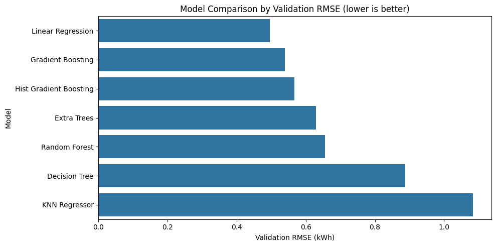

# EV Energy Prediction

### A Machine Learning Approach to Predicting Electric Vehicle Energy Consumption

<div align="center">


**Predicting electric vehicle energy consumption using driving behavior, road conditions, weather, and battery-related features.**

</div>

---

# 1. Project Overview

Electric vehicles depend on battery energy, and their energy consumption varies according to several driving and environmental conditions.

This project develops a supervised Machine Learning Regression model to predict **Electric Vehicle Energy Consumption (kWh)** using different vehicle and environmental features.

The project follows a complete Machine Learning workflow, starting with data loading and exploration, followed by data cleaning, feature engineering, preprocessing, model training, evaluation, and feature importance analysis.

The main target variable is:

`Energy_Consumption_kWh`

---

# 2. Problem Statement

Electric vehicle energy consumption is affected by multiple factors, including:

- Driving speed and acceleration.
- Battery state and temperature.
- Road type and slope.
- Traffic conditions.
- Weather and environmental conditions.
- Distance travelled.
- Tire pressure.

Understanding these factors can help estimate the energy required by an electric vehicle during a trip.

**The main problem addressed in this project is predicting the amount of energy an electric vehicle consumes based on its driving and operating conditions.**

Since the target variable is continuous and numerical, this project is formulated as a **Regression Problem**.

---

# 3. Project Objectives

- Develop a Machine Learning model to predict EV energy consumption.
- Understand and analyze the dataset.
- Perform data quality checks and basic cleaning.
- Explore relationships between input features and energy consumption.
- Identify correlations and inspect potential outliers.
- Apply feature engineering to extract useful time information.
- Prepare numerical and categorical features.
- Compare different regression algorithms.
- Evaluate models using appropriate regression metrics.
- Identify the most influential features using Permutation Importance.

---

# 4. Dataset Description

The project uses the **EV Energy Consumption Dataset** obtained from Kaggle.

**Dataset Source:**

[EV Energy Consumption Dataset – Kaggle](https://www.kaggle.com/datasets/ziya07/ev-energy-consumption-dataset)

The original dataset contains:

- **5,000 observations**
- **19 columns**

## 4.1 Dataset Features

| Feature | Description | Type |
|---|---|---|
| Vehicle_ID | Vehicle identifier | Identifier |
| Timestamp | Date and time of observation | DateTime |
| Speed_kmh | Vehicle speed in km/h | Numerical |
| Acceleration_ms2 | Vehicle acceleration in m/s² | Numerical |
| Battery_State_% | Battery state percentage | Numerical |
| Battery_Voltage_V | Battery voltage | Numerical |
| Battery_Temperature_C | Battery temperature | Numerical |
| Driving_Mode | Driving mode category | Categorical |
| Road_Type | Road type category | Categorical |
| Traffic_Condition | Traffic condition category | Categorical |
| Slope_% | Road slope percentage | Numerical |
| Weather_Condition | Weather category | Categorical |
| Temperature_C | Ambient temperature | Numerical |
| Humidity_% | Relative humidity | Numerical |
| Wind_Speed_ms | Wind speed in m/s | Numerical |
| Tire_Pressure_psi | Tire pressure | Numerical |
| Vehicle_Weight_kg | Vehicle weight in kg | Numerical |
| Distance_Travelled_km | Distance travelled in km | Numerical |
| Energy_Consumption_kWh | Energy consumed in kWh | Target |

## 4.2 Target Variable

The target variable is:

`Energy_Consumption_kWh`

It represents the amount of electrical energy consumed by the vehicle, measured in kilowatt-hours (kWh).

The remaining eligible features are used as inputs to predict this value.

---

# 5. Project Workflow

The following sections describe the implementation in the same order as the Python code.

## 5.1 Import Libraries and Load the Dataset

The project begins by importing the required Python libraries:

- Pandas and NumPy for data manipulation and numerical operations.
- Matplotlib and Seaborn for data visualization.
- Scikit-learn for preprocessing, model training, and evaluation.

The dataset is loaded into a Pandas DataFrame.

The `Timestamp` column is converted into datetime format to allow time-based feature extraction.

### Initial Data Inspection

The following operations are performed:

- Display the first five rows.
- Check dataset dimensions.
- Inspect data types.
- Count missing values.
- Check duplicate records.

**Initial Dataset Shape: 5,000 rows × 19 columns.**

## 5.2 Basic Data Cleaning

A working copy of the dataset is created before applying basic cleaning operations.

The following steps are performed:

1. Remove exact duplicate rows.
2. Remove rows containing invalid timestamps.
3. Sort records chronologically.
4. Reset the DataFrame index.

The dataset shape is displayed after cleaning to verify the result.

**Purpose:** Ensure that the dataset is consistently prepared before performing analysis and modeling.

## 5.3 Define the Target and Categorical Features

The target variable is defined as:

`Energy_Consumption_kWh`

The following columns are identified as categorical:

- `Driving_Mode`
- `Road_Type`
- `Traffic_Condition`
- `Weather_Condition`

Although these features may contain numerical codes, they represent categories rather than continuous measurements.

The frequency of each category is displayed to understand the distribution of categorical values.

## 5.4 Exploratory Data Analysis (EDA)

Exploratory Data Analysis is performed to understand the dataset and identify patterns before model training.

### A. Energy Consumption Distribution

A histogram with a KDE curve is generated to visualize the distribution of `Energy_Consumption_kWh`.

<div align="center">

</div> 

This chart helps identify:

- The distribution of energy consumption.
- The most frequent consumption ranges.
- The spread of energy consumption values.

### B. Energy Consumption by Categorical Features

Boxplots are generated to compare energy consumption across:

- Driving Mode.
- Road Type.
- Traffic Condition.
- Weather Condition.

These plots help examine differences in median values, data spread, and potential extreme observations.

### C. Numerical Features vs. Energy Consumption

Scatter plots are created to investigate relationships between energy consumption and selected numerical features:

- `Speed_kmh`
- `Acceleration_ms2`
- `Battery_State_%`
- `Battery_Temperature_C`
- `Slope_%`
- `Temperature_C`
- `Distance_Travelled_km`

These visualizations help identify patterns and associations between numerical features and the target variable.

## 5.5 Correlation Analysis

Pearson correlation is calculated to measure the strength and direction of linear relationships between numerical features.

<div align="center">

</div> 

A correlation heatmap is generated to visualize these relationships.


### Interpretation

- Speed has the strongest positive linear correlation with energy consumption.
- Distance travelled has a moderate positive correlation.
- Battery state has a weak negative correlation.

Features are also ranked according to their absolute correlation values.

**Note:** Correlation indicates association, not causation.

## 5.6 Outlier Inspection

Potential outliers are inspected using the Interquartile Range (IQR) method.

The IQR is calculated as:

`IQR = Q3 - Q1`

The boundaries are:

```text
Lower Bound = Q1 - 1.5 × IQR

Upper Bound = Q3 + 1.5 × IQR
```

Values below the lower boundary or above the upper boundary are counted as potential outliers.

The code generates an outlier summary containing:

- Feature name.
- Lower boundary.
- Upper boundary.
- Number of detected outliers.

**Recorded Result:** Zero IQR outliers were detected in the inspected numerical columns and target variable.

This step is used for inspection only. No observations are automatically removed.

## 5.7 Feature Engineering

Feature Engineering is applied to extract useful information from the `Timestamp` column.

Two new features are created:

| Feature | Description |
|---|---|
| Hour_of_Day | Hour of the observation (0–23) |
| Day_of_Week | Day of the week (Monday = 0, Sunday = 6) |

The code checks invalid timestamps and displays the newly created features.

The original `Timestamp` column is excluded from the model inputs after extracting the useful time information.

## 5.8 Prepare Features and Target

The dataset is divided into two main components:

- **X:** Input features.
- **y:** Target variable.

The following columns are excluded from the input features:

- `Energy_Consumption_kWh`: The target variable.
- `Vehicle_ID`: An identifier rather than a direct operating measurement.
- `Timestamp`: Its useful information is represented by the engineered time features.

The categorical features used in the modeling stage are:

- `Driving_Mode`
- `Road_Type`
- `Traffic_Condition`
- `Weather_Condition`
- `Hour_of_Day`
- `Day_of_Week`

All remaining input columns are identified as numerical features.

**Result: 18 input features before preprocessing.**

## 5.9 Train, Validation, and Test Split

The dataset is divided into three subsets using `train_test_split()`.

The split is performed using `random_state=42` to ensure reproducibility.

| Dataset | Percentage | Purpose |
|---|---:|---|
| Training Set | 70% | Train the models |
| Validation Set | 10% | Compare models and select the best one |
| Test Set | 20% | Evaluate the selected model |

The code also verifies that there is no overlap between the three datasets.

**Important:** The data is randomly split, even though it was sorted chronologically during cleaning.

## 5.10 Data Preprocessing

A preprocessing pipeline is created to handle numerical and categorical features separately.

### Numerical Preprocessing

Two operations are applied:

1. **Median Imputation:** Replaces missing numerical values with the median.
2. **Standard Scaling:** Standardizes numerical features using `StandardScaler`.

### Categorical Preprocessing

Two operations are applied:

1. **Most Frequent Imputation:** Replaces missing categorical values with the most frequent category.
2. **One-Hot Encoding:** Converts categorical values into binary columns.

The two preprocessing pipelines are combined using `ColumnTransformer`.

The preprocessing operations are included inside the Scikit-learn Pipeline to prevent data leakage.

This ensures that preprocessing parameters are learned from training data rather than validation or test data.

## 5.11 Cross-Validation

Five-Fold Cross-Validation is performed using the training set.

The training data is divided into five folds.

Each model is trained and evaluated across the folds to obtain more reliable performance estimates.

The evaluation includes:

- Mean CV RMSE.
- Standard Deviation of RMSE.
- Mean CV MAE.
- Mean CV R².

A bar chart is generated to compare models based on their mean cross-validation RMSE.

The preprocessing pipeline is included during cross-validation to prevent information leakage.

## 5.12 Model Training and Validation Comparison

Seven regression models are trained and evaluated using the training and validation datasets.

The following table compares the performance of seven regression models on the validation dataset using MAE, RMSE, and R² metrics.

| Model | MAE | RMSE | R² |
|---|---:|---:|---:|
| **Linear Regression** | **0.3946** | **0.4964** | **0.9517** |
| Gradient Boosting | 0.4246 | 0.5401 | 0.9428 |
| Hist Gradient Boosting | 0.4471 | 0.5667 | 0.9370 |
| Extra Trees | 0.5014 | 0.6287 | 0.9225 |
| Random Forest | 0.5171 | 0.6550 | 0.9159 |
| Decision Tree | 0.7013 | 0.8883 | 0.8453 |
| KNN Regressor | 0.8600 | 1.0831 | 0.7700 |

**Selected Model:** Linear Regression

**Best Validation RMSE:** 0.4964 kWh

<div align="center">

</div>

Linear Regression achieved the best validation performance among all seven models, with the lowest MAE and RMSE and the highest R² score. Therefore, it was selected for the final test evaluation.

## 5.13 Final Test Evaluation

After selecting the best model using validation results, the selected model is evaluated on the test dataset.

The final evaluation uses three regression metrics:

- Test MAE.
- Test RMSE.
- Test R².

The test dataset is kept separate during model selection to provide an evaluation on unseen observations.

The final metric values are generated when the notebook is executed.

## 5.14 Actual vs. Predicted Values

The following table compares the actual energy consumption values with the values predicted by the selected Linear Regression model for the first 10 test records.

The absolute error represents the difference between the actual and predicted values.

| Test Index | Actual Energy (kWh) | Predicted Energy (kWh) | Absolute Error (kWh) |
|---:|---:|---:|---:|
| 790 | 10.752 | 10.575 | 0.177 |
| 2879 | 8.862 | 8.728 | 0.134 |
| 2372 | 10.050 | 9.671 | 0.379 |
| 1351 | 12.799 | 13.254 | 0.455 |
| 3382 | 6.283 | 6.108 | 0.175 |
| 3433 | 8.448 | 8.911 | 0.463 |
| 1129 | 12.804 | 12.818 | 0.014 |
| 549 | 5.897 | 5.309 | 0.588 |
| 2835 | 7.261 | 7.494 | 0.233 |
| 626 | 5.081 | 5.532 | 0.451 |

The results show that the predicted values are generally close to the actual values. The absolute error helps measure how far each prediction is from the real energy consumption.

The smallest error is 0.014 kWh, while the largest error is 0.588 kWh among these 10 records.

## 5.15 Feature Importance (Permutation Importance)

Permutation Importance is used to understand which input features contribute most to the selected model's predictive performance.

The procedure works as follows:

1. Use the selected model and validation dataset.
2. Shuffle one feature at a time.
3. Measure the decrease in model performance.
4. Repeat the process five times.
5. Calculate the mean importance and standard deviation.

The results are sorted according to mean importance.

The top ten features are displayed in a table and a horizontal bar chart.

A higher importance value indicates that shuffling the feature causes a larger decrease in model performance.

**Note:** Feature importance indicates predictive usefulness, not causation.

---

# 6. Models Used

The project compares seven regression algorithms:

| Model | Description |
|---|---|
| Linear Regression | Models a linear relationship between input features and the target. |
| KNN Regressor | Predicts values based on nearby observations. |
| Decision Tree Regressor | Uses decision rules to predict energy consumption. |
| Random Forest Regressor | Combines multiple decision trees to improve prediction. |
| Extra Trees Regressor | Uses randomized decision trees in an ensemble. |
| Gradient Boosting Regressor | Builds models sequentially to improve previous predictions. |
| Hist Gradient Boosting Regressor | Uses histogram-based gradient boosting for efficient training. |

All models use the same preprocessing approach and data partitions.

The final model is selected according to the lowest validation RMSE.

---

# 7. Evaluation Metrics

Three main regression metrics are used.

| Metric | Description | Preferred Value |
|---|---|---|
| MAE | Average absolute difference between actual and predicted values. | Lower |
| RMSE | Measures prediction errors while giving greater weight to larger errors. | Lower |
| R² | Measures how much variation in the target is explained by the model. | Higher |

MAE and RMSE are expressed in kWh.

---

# 8. Technology Stack

### Programming Language

- Python 3.x

### Development Environment

- Jupyter Notebook
- Google Colab

### Python Libraries

| Category | Libraries |
|---|---|
| Data Manipulation | Pandas, NumPy |
| Data Visualization | Matplotlib, Seaborn |
| Machine Learning | Scikit-learn |

---

# 9. Repository Structure

```text
EVEnergyPrediction/
│
├── assets/
│   ├── ev-energy-prediction-cover.png
│   ├── feature-correlations.png
│   ├── model-comparison.png
│   └── target-distribution.png
│
├── Data/
│   └── EV_Energy_Consumption_Dataset.csv
│
├── code/
│   └── EV_Energy_Prediction.ipynb
│
├── README.md
└── requirements.txt
```

This structure represents the main project files. Additional milestone files or datasets can be added when they are included in the repository.

---

# 10. How to Run the Project

## Option 1: Google Colab

1. Open the project notebook in Google Colab.
2. Upload the dataset CSV file.
3. Ensure the file is available at the path used in the notebook:

```python
df = pd.read_csv("/content/EV_Energy_Consumption_Dataset.csv")
```

4. Run all cells in order, from top to bottom.

## Option 2: Run Locally

### Step 1: Clone the Repository

```bash
git clone https://github.com/Rama-AlJufout/EVEnergyPrediction.git

cd EVEnergyPrediction
```

### Step 2: Create a Virtual Environment

**Windows:**

```bash
python -m venv .venv

.venv\Scripts\activate
```

**macOS / Linux:**

```bash
python -m venv .venv

source .venv/bin/activate
```

### Step 3: Install Dependencies

```bash
python -m pip install --upgrade pip

pip install -r requirements.txt
```

### Step 4: Launch Jupyter Notebook

```bash
jupyter notebook
```

Open the notebook:

`code/EV_Energy_Prediction.ipynb`

Run the cells sequentially.

**Note:** Update the dataset path in the code if the CSV file is stored in a different location.

---

# 11. Limitations and Future Improvements

- Explore chronological data splitting to simulate predicting future trips.
- Confirm the meanings of encoded categorical values using the original dataset documentation.
- Apply hyperparameter tuning to investigate potential performance improvements.
- Evaluate the selected model on independent real-world EV data.
- Save the complete preprocessing and modeling pipeline for future predictions.
- Monitor incoming data to identify possible changes in vehicle behavior and operating conditions.

---

# 12. Team Members

- Rama AlJufout
- Areen Ahmad AlJarrah
- Osama Nayfeh
- Ra'fat Osama Falah AlDiabat

---

# 13. References

- [EV Energy Consumption Dataset – Kaggle](https://www.kaggle.com/datasets/ziya07/ev-energy-consumption-dataset)
- [EV Energy Prediction – GitHub Repository](https://github.com/Rama-AlJufout/EVEnergyPrediction)

---

<div align="center">

**EV Energy Prediction**

*Machine Learning Regression Project*

</div>